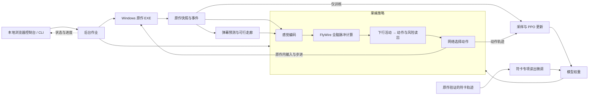
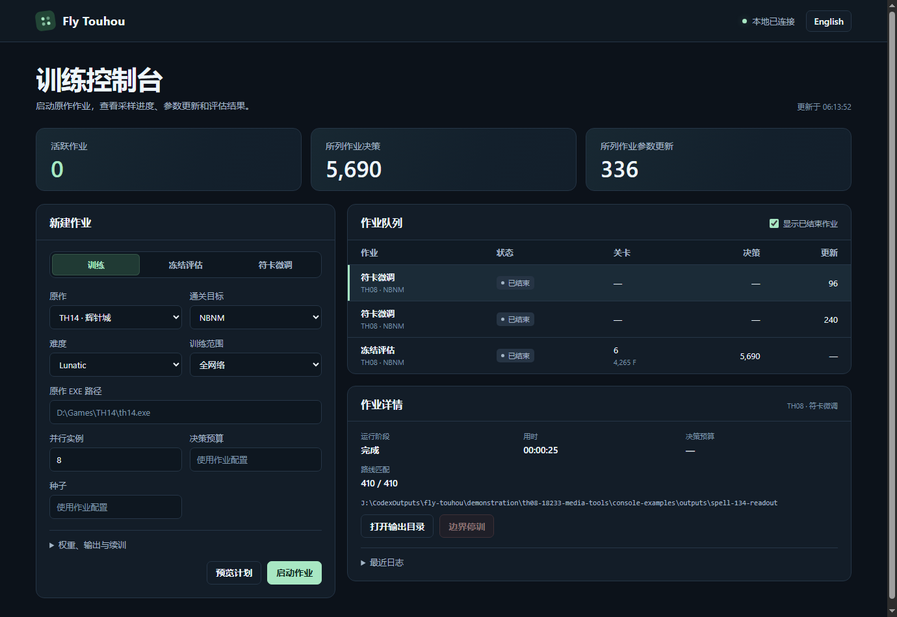
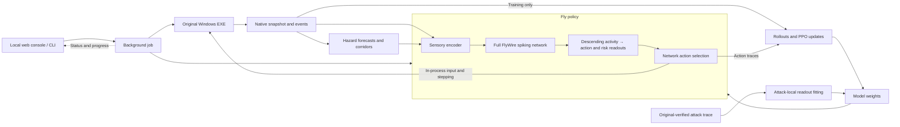

# 果蝇东方 / Fly Touhou

[中文](#中文) · [English](#english) · [工作原理](#工作原理) · [浏览器控制台](#浏览器控制台)

## 中文

### 支持矩阵

一个完整的 FlyWire 连接组约束脉冲网络读取原作状态并自主选择动作。训练与评估使用 Windows 上的原作进程。

| 原作 | 难度与自机 | `clear` | `nbnm` |
| --- | --- | --- | --- |
| 《东方辉针城》TH14 1.00b | Lunatic，灵梦 A | 支持 | 支持 |
| 《东方永夜抄》TH08 1.00d | Lunatic，结界组 | 待适配 | 支持 |

原作、难度、目标和训练范围分别选择。示例配置覆盖上表所列组合。

### 安装

使用 Windows x64、Python 3.11、NVIDIA CUDA 和 Git LFS。请自行提供原作 EXE 和同版本游戏数据。

```powershell
git lfs install
git clone https://github.com/cangyun/fly-touhou.git
Set-Location fly-touhou
git lfs pull
py -3.11 -m venv .venv
.\.venv\Scripts\Activate.ps1
python -m pip install torch==2.8.0 --index-url https://download.pytorch.org/whl/cu128
python -m pip install -r requirements-repro.txt
python -m pip install -e . --no-deps
python scripts/setup_release.py
```

已有图谱可在最后一步加 `--data-source D:\flywire-v783`。原作版本与依赖见[复现说明](docs/REPRODUCING.md)。

### 快速开始

```powershell
fly-touhou evaluate --game th14 --difficulty lunatic --objective clear --game-exe "D:\Games\TH14\th14.exe"
fly-touhou train --game th08 --difficulty lunatic --objective nbnm --train-scope encoder-heads --game-exe "D:\Games\TH08\th08.exe" --dry-run
fly-touhou console
```

`--dry-run` 打印启动计划。

### 工作原理



原作适配器读取自机、敌机、弹幕、激光和原作事件。几何预测提供各候选的碰撞余量与路线特征，模型通过感觉编码刺激连接组，由下行神经元的活动读出动作分数。冻结评估载入权重后执行这个闭环。符卡微调可使用原作已验证的轨迹单独更新指定读出。 [代码地图](docs/code-map.md) · [原作接口](docs/original-game-interfaces.md)

### 浏览器控制台

运行 `fly-touhou console`，或双击虚拟环境中的 `Scripts\fly-touhou-console.exe`，即可打开本机浏览器控制台。选择训练、冻结评估或 TH08 符卡微调，填写所需的原作或轨迹路径，再预览计划或启动作业。



默认只显示活跃作业。勾选 **显示已结束作业** 查看历史。选中作业可查看决策数、参数更新、原作结果和日志，打开输出目录或请求边界停训。关闭页面后，后台作业继续运行。服务监听 `127.0.0.1:18768`，可用 `--port` 和 `--jobs` 指定端口与作业目录。命令行管理用 `fly-touhou status --active` 和 `fly-touhou stop <job>`。

### 两种通关目标

- **`clear`** 允许自主 Bomb。中弹后用剩余残机继续，按有限残机、不续关的 1CC 验收。
- **`nbnm`** 禁用 Bomb，首次原作碰撞终止。要求零 Miss、零 Bomb、零续关到达结局。

`--objective clear --difficulty lunatic` 选择 Lunatic 1CC。

### 两种训练范围

- **`joint`** 更新感觉编码、输出头与已参数化的脑内参数。连接组拓扑固定。
- **`encoder-heads`** 固定脑内参数并照常推进脑状态。感觉编码器仍可通过脑网络接收梯度，配置指定的输出组可更新。

同设定用 `--resume` 恢复优化器。新设定用 `--checkpoint` 载入兼容权重并初始化 Adam。TH08 符卡专项读出用 `fit-attack`。 [训练与局部微调](docs/TRAINING.md)

### 训练方案与后续方向

[训练方案与扩展方向](docs/ROADMAP.md#中文) 记录从连接组初始化、避弹监督和真人录像模仿，到普通通关 PPO 与 NBNM 迁移的五个阶段。后续对照覆盖感觉编码与输出头容量、奖励、预测效率、训练配方、能力保持和其他原作。

### 已有成果与复现入口

| 原作与目标 | 已有原作成绩 | 证据 |
| --- | --- | --- |
| TH14 Lunatic 1CC | 第 87 批策略在种子 3574003864 通关 | [报告](results/clear-v6.json) |
| TH14 Lunatic NBNM | 第 73 批策略在种子 60036 无伤通关 | [报告](results/th14-nbnm-60036.json) |
| TH08 Lunatic NBNM | 种子 18233 到达 6A 正常结局，零碰撞、零 Bomb、零 Miss、零续关 | [报告](results/th08-nbnm-18233.json) |

[复现说明](docs/REPRODUCING.md) · [代码地图](docs/code-map.md) · [原作接口](docs/original-game-interfaces.md)

代码采用 **AGPL-3.0-or-later**。权重、数据和原生组件的来源及分发条件见[第三方声明](THIRD_PARTY_NOTICES.md)。

## English

### Support matrix

One spiking network constrained by the full FlyWire connectome observes the original game and chooses its actions. Training and evaluation run the original Windows executable.

| Original game | Rank and shot | `clear` | `nbnm` |
| --- | --- | --- | --- |
| Double Dealing Character, TH14 1.00b | Lunatic, Reimu A | Supported | Supported |
| Imperishable Night, TH08 1.00d | Lunatic, Border Team | Pending | Supported |

Choose the game, rank, objective, and training scope separately. The presets cover the combinations above.

### Installation

Use Windows x64, Python 3.11, NVIDIA CUDA, and Git LFS. Supply your own original executable and game data.

```powershell
git lfs install
git clone https://github.com/cangyun/fly-touhou.git
Set-Location fly-touhou
git lfs pull
py -3.11 -m venv .venv
.\.venv\Scripts\Activate.ps1
python -m pip install torch==2.8.0 --index-url https://download.pytorch.org/whl/cu128
python -m pip install -r requirements-repro.txt
python -m pip install -e . --no-deps
python scripts/setup_release.py
```

Add `--data-source D:\flywire-v783` on the last step to reuse graph files. See [reproduction](docs/REPRODUCING.md) for the game builds and dependencies.

### Quick start

```powershell
fly-touhou evaluate --game th14 --difficulty lunatic --objective clear --game-exe "D:\Games\TH14\th14.exe"
fly-touhou train --game th08 --difficulty lunatic --objective nbnm --train-scope encoder-heads --game-exe "D:\Games\TH08\th08.exe" --dry-run
fly-touhou console
```

`--dry-run` prints the launch plan.

### How it works



The adapter reads the player, enemies, bullets, lasers, and original-game events. Geometric forecasts provide collision margins and route features for each candidate. The sensory encoder feeds these observations into the connectome, and descending activity supplies action scores. Frozen evaluation loads weights and runs the same inference loop. Attack-local fitting can update selected readouts from an original-verified trajectory. [Code map](docs/code-map.md) · [Original-game interfaces](docs/original-game-interfaces.md)

### Browser console

Run `fly-touhou console` or double-click `Scripts\fly-touhou-console.exe` in the virtual environment to open the local dashboard. Choose training, frozen evaluation, or TH08 attack-local fitting, then provide the original-game or verified guide path to preview the plan or start the job.


The default queue shows active jobs. Enable **Show completed jobs** to inspect history. Select a job for decision and optimizer counts, original-game results, logs, the output folder, and boundary stop controls. Jobs continue when the browser tab closes. The console listens on `127.0.0.1:18768`. Use `--port` and `--jobs` to set the port and job directory. The CLI also provides `fly-touhou status --active` and `fly-touhou stop <job>`.

### Clear objectives

- **`clear`** allows autonomous Bomb use and continues after a Miss while stock remains. It requires a finite-life one-credit clear.
- **`nbnm`** disables Bomb and ends at the first original-game contact. It requires an ending with zero Miss, Bomb, and continues.

`--objective clear --difficulty lunatic` selects Lunatic 1CC.

### Training scopes

- **`joint`** updates the encoder, readouts, and existing trainable brain parameters. The wiring stays fixed.
- **`encoder-heads`** freezes brain parameters and advances the recurrent state. Gradients reach the encoder through the brain and the named output groups can update.

Use `--resume` to restore the optimizer for matching settings. Use `--checkpoint` to start a new optimizer from compatible weights. TH08 attack-local readouts use `fit-attack`. [Training and local adaptation](docs/TRAINING.md)

### Training plan and roadmap

The [training plan and roadmap](docs/ROADMAP.md#english) covers five stages from connectome initialization, bullet-avoidance supervision, and human replay imitation to regular-clear PPO and NBNM transfer. It also sets out capacity, reward, forecast speed, training recipe, retention, and game adaptation experiments.

### Results and reproduction

| Original game and objective | Existing original-game result | Evidence |
| --- | --- | --- |
| TH14 Lunatic 1CC | Cycle 87 clears on seed 3574003864 | [Report](results/clear-v6.json) |
| TH14 Lunatic NBNM | Cycle 73 clears without a hit on seed 60036 | [Report](results/th14-nbnm-60036.json) |
| TH08 Lunatic NBNM | Seed 18233 reaches the 6A normal ending with zero contacts, Bombs, Misses, and continues | [Report](results/th08-nbnm-18233.json) |

[Reproduction](docs/REPRODUCING.md) · [Code map](docs/code-map.md) · [Original-game interfaces](docs/original-game-interfaces.md)

Code is **AGPL-3.0-or-later**. See [third-party notices](THIRD_PARTY_NOTICES.md) for weights, FlyWire data, and native components.
